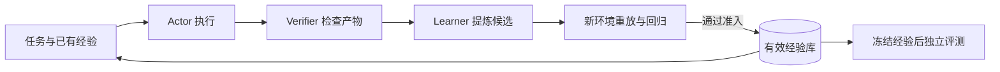

  
  

    
    <strong>I'm currently Focus on Agent Tool-Use, Eval, SFT/Distill and Inference.</strong>
  

  

    <code>实践、认识、再实践、再认识……循环往复以至无穷。  蒸馏永远达不到agi</code>
  

<table>
<tr>
<td valign="top" width="50%">

#### 💼 Work Experience

> 📄 [View Experience →](https://github.com/xiaojunjie222/xiaojunjie222/blob/main/Awards.md)

<strong>自变量机器人</strong> -- <code>Harrix Serving · PI0.5 · Token Billing</code> 
<strong>科大讯飞</strong> -- <code>Agent Tool-Use · Dialogue · Eval · SFT/Distill</code> 
<strong>华为</strong> -- <code>MetaERP · 供应链 · 应付发票 · 断供替换</code> 

> 🏆 [View Awards →](https://github.com/xiaojunjie222/xiaojunjie222/blob/main/Awards.md)

- 🏅 **华为 · 英雄强渡大渡河奖** — [MetaERP 替换](https://github.com/xiaojunjie222/xiaojunjie222/blob/main/huawei.md)
- 🏅 **科大讯飞 CBG 首届黑客马拉松优秀奖** — [搭了个搭](https://github.com/xiaojunjie222/xiaojunjie222/blob/main/iflytek.md)
- 🏅 **自变量机器人 · 极致优化奖** — [Harrix Serving](https://github.com/xiaojunjie222/xiaojunjie222/blob/main/x2robot.md)

</td>
<td valign="top" width="48%">

#### 💻 Open Source Experience

> 📂 [View Projects →](https://github.com/xiaojunjie222/xiaojunjie222/blob/main/Awards.md)

- 🧠 **[llm-from-scratch](https://github.com/xiaojunjie222/llm-from-scratch)** — 从零手写 Transformer，支持思维链推理
- ⚙️ **[llm-quantization-toolkit](https://github.com/xiaojunjie222/llm-quantization-toolkit)** — Qwen / DeepSeek / LLaMA 量化
- 🔐 **[rbac-permission-system-java](https://github.com/xiaojunjie222/rbac-permission-system-java)** — Spring Boot + JWT 权限系统
- ⏱️ **[time-dashboard](https://github.com/xiaojunjie222/time-dashboard)** — 时间管理 Web 应用

</td>
</tr>
</table>

---

#### 🧠 RSI Agent：通过可验证经验改进执行策略

我在探索让 Agent 从任务经历中积累可复用经验：执行任务、独立验证实际产物、总结候选规则，再通过重放与回归检查决定哪些经验可以长期保存。后续任务使用这些经验，产生新的执行记录与候选规则，形成持续迭代的闭环。

- **角色分工**：Actor 执行，Verifier 检查，Learner 总结，Curriculum 从允许的练习池选择后续任务。学习过程不能修改验收标准。
- **经验准入**：失败修复要求原任务从失败变为成功，且此前成功的练习仍通过；成功流程总结则单独记录为经过重放验证的经验，其效果交由独立评测判断。
- **递归复用**：通过检查的规则进入持久记忆，按任务范围检索并注入下一轮模型输入。当前更新的是外部经验，不涉及模型参数训练。
- **效果验证**：固定模型、工具与执行预算，对比空记忆和冻结经验；评测期间禁止写回经验，同时记录成功率、动作次数及包含学习阶段的调用成本。

当前原型已完成真实模型的小样本对照：空记忆与携带一条冻结经验均为 **4/4**，工具动作数均为 **12**。经验生成、验证和复用链路已跑通，**尚未测得成功率或动作效率提升**；后续重点验证经验能否迁移到未见任务，以及长期积累后的相关性、冲突与成本。

#### 📝 具身模型与推理笔记

##### 推理学习与源码笔记

- **[Wall-X 算子优化：融合、访存与数据布局](./notes/wallx-operator-optimization.md)**
  整理 SwiGLU、RMSNorm、RoPE、QKV 后处理、固定双专家重排、原生 GQA 与 GEMM 对齐，逐项说明优化机制、收益来源、适用条件和验证方法。

- **[Harrix 机器人推理优化详解](./notes/robot-inference-optimization.md)**
  从客户端到动作执行，梳理 prefill、KV cache、denoise、算子融合与 CUDA Graph，附 5 张流程图、张量变化表及性能定位方法。

- **[VGA 推理加速](./notes/vga-inference-acceleration.md)**
  VGA 是世界动作模型：先在 latent 里生成未来画面，再从画面特征里读出动作。笔记对照 native 引擎源码，说明每一处已经落地的加速省掉的是哪一段时间。

- **[机器人动作 Tokenizer 与多模态训练详解](./notes/action-tokenizer-and-multimodal-training.md)**
  从动作坐标与 6D 旋转表示出发，拆解 Encoder、RVQ 码本、Decoder 和两阶段训练，再串起图像、指令、动作 token 的拼接、AR 监督与评测。

##### 工程问题与解决记录

- **[机器人接管后“窜一下”：成因、修复与取舍](./notes/robot-action-dispatch-improvements.md)**
  解释 Python、DDS 与 C++ 中的旧动作为何会越过清队列，并梳理三层版本校验、reset 屏障及其代价。

- **[Python 上层控制链优化与工程取舍](./notes/robot-python-control-pipeline-optimizations.md)**
  梳理异步生产消费、执行进度反馈、compact raw、锁外发布和 RTC 过期结果处理，并区分性能优化与正确性保护。

- **[机器人动作频率适配与姿态转换优化](./notes/robot-control-rate-and-rotation.md)**
  解释模型关键帧与高频控制下发如何衔接，串起插值补点、四元数与 SLERP、删除姿态转换往返和 C++ raw 下发，区分姿态过渡、CPU 处理与传输开销的改善。

#### 🔜 计划落地

- **双臂机器人操作**
  针对 pick and place、叠衣服等场景单独训练，训练完成后再单独做推理优化。参考 [SwanLab · LeRobot 具身智能入门](https://docs.swanlab.cn/examples/robot/lerobot-guide.html)。这一项还没落地。

#### 📌 Experience Details

- [自变量机器人 | Harrix 具身推理服务](./x2robot.md)
- [科大讯飞 | Agent 工具调用 · 对话 · 评测 · 微调蒸馏](./iflytek.md)
- [华为 | S 级 MetaERP 替换 · 供应链 / 应付发票](./huawei.md)

  
   
  
  

