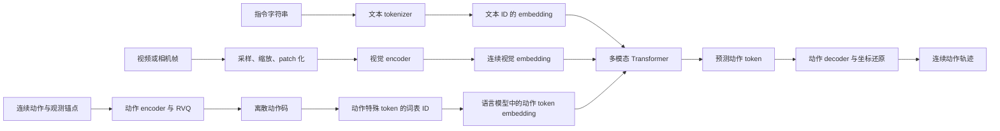
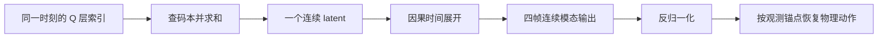

# 机器人动作 Tokenizer 与多模态训练详解

本文讨论一套基于 Transformer 与残差向量量化（RVQ）的动作 codec，以及它在视觉语言动作模型中的接入方式。重点是数据表示、张量形状、训练目标和工程边界，而不是把所有模态都笼统称为“token”。

版本范围：动作侧以动作 codec 仓库的 `37df6ac` 快照及其中的 v3.3-AR 实现为准；模型接入侧以 Wall-X 的 `ff025002` 快照为准。它们是本文的源码审阅基线，不代表仓库最新版本。不同 checkpoint 可以保存不同的归一化、序列协议、decoder 结构和动作跨度，本文中的形状示例不替代 checkpoint 的实际配置。下面的伪代码用于解释机制，不是可直接启动训练的配置或部署脚本。

阅读顺序：先看第 2—5 节理解动作怎样变成码，再看第 6—7 节理解 codec 怎样训练，最后看第 8—11 节理解它怎样接入 VLA、怎样评测和搭建。

## 1. 三种 Token，三个不同的问题

文本 tokenizer 把指令字符串切成词表 ID，例如一条中文指令经过子词切分后变成整数序列。动作 codec 则接收连续轨迹，学习用有限码本中的索引表示一段运动。视觉分支通常先把视频拆成帧、划成 patch，再输出连续特征向量；这些向量也常被称为视觉 token，但它们不必对应一个离散码本 ID。

| 对象 | 输入 | 主要输出 | 核心作用 |
|---|---|---|---|
| 文本 tokenizer | 指令、对话字符串 | 子词 ID | 将语言送入语言模型 |
| 动作 codec | 多步连续动作及观测锚点 | RVQ 索引与可重建的动作 | 压缩运动，提供动作预测目标 |
| 视觉 encoder | 图像或视频帧像素 | 连续视觉 embedding | 提取视觉条件 |

因此，“视频、指令和动作进入同一个模型”不代表它们先经过同一个 tokenizer。它们在各自前端完成处理，最后在模型的隐藏维度上组装成可共同计算的序列。



训练时，真实未来动作可以用于生成监督目标；推理时，未来动作码由模型预测，不能把真实未来轨迹作为输入条件。这是理解整条链路时最重要的区分之一。

## 2. 动作进入网络之前，先把表示约定写清楚

一个常见的双臂布局是：每只手包含位置 3 维、旋转 6 维、夹爪 1 维，两臂合计 20 维。再加入底盘速度 3 维、高度 1 维和头部 2 维，就得到 26 维。这些数字描述动作表示的宽度，不等于物理自由度：例如 6D 旋转仍然表达 3 个旋转自由度。不同机器人也不一定具有全部 26 个有效表示分量。

v3.3-AR 的 token I/O 接收模态字典，例如位置、旋转、夹爪各自一组张量。每个样本另带模态是否存在、实际维数和时间有效性。这样可以在一个 batch 中处理缺失模态或不同宽度的关节通道；它并不意味着未训练的新机器人可以自动获得可靠的运动能力。

旋转使用行式 6D 表示：取旋转矩阵的前两行，依次展开为六个数。还原时先将第一组三维向量归一化，再从第二组中去掉沿第一组的投影，归一化后用叉积构造第三个方向。6D 连续表示的背景可参考论文 [On the Continuity of Rotation Representations in Neural Networks](https://arxiv.org/abs/1812.07035)；行或列的存储选择仍须由具体实现约定。这个约定必须与数据转换、统计、训练和推理保持一致，不能直接与取矩阵前两列的另一种 6D 约定互换。

动作还可以相对于观测锚点表示。令当前末端位姿为位置 p₀、旋转 R₀，未来目标为 pₜ、Rₜ。在本文实现的 body 坐标约定中，采用列向量写法时：

```text
位置相对量：δpₜ = R₀ᵀ (pₜ − p₀)
旋转相对量：δRₜ = R₀ᵀ Rₜ

还原位置：pₜ = p₀ + R₀ δpₜ
还原旋转：Rₜ = R₀ δRₜ
```

这里的 body 指锚点对应末端的局部坐标约定，不应自动理解为底盘坐标。若使用行向量存储，位置公式等价写成 `(pₜ − p₀) @ R₀`。base 坐标旋转相对量采用另一种乘法顺序，二者不能混用。

旋转相对量的实际计算顺序是 `6D → 旋转矩阵 → 相对矩阵 → 6D`，不是把六个数逐项相减。body 约定中的零相对旋转是单位矩阵，其行式 6D 为 `[1,0,0,0,1,0]`，不是全零。base 约定使用 `δRₜ = Rₜ R₀ᵀ`，还原时为 `Rₜ = δRₜ R₀`。

归一化统计还决定网络实际看到的数值。审阅的基础配置采用 body 相对动作和固定 chunk 口径的统计；实现也支持逐时间步统计。更换统计口径会改变训练目标，而不只是改变文件组织。位置、夹爪等通道的物理单位也必须由数据契约确认，不能因为输出数值很小就直接换算成毫米。

min-max 归一化还会裁剪到 `[-1,1]`，超出统计范围的信息可能在进入 RVQ 前就已丢失。反归一化之后再重建旋转矩阵；6D 输入若接近全零或两个向量近共线，单靠数值 epsilon 也不能保证得到可靠旋转。

## 3. Encoder：先聚合动作维度，再压缩时间

为便于说明，设 batch 大小 B=2，动作长度 T=32，共有 K=26 个有效标量通道，隐藏维度 H=1024，时间压缩率 c=4。模态字典在概念上对应 `[2,32,26]`，观测锚点作为独立条件传入，不需要把它冒充未来动作中的一帧。

在 token I/O 中，每个标量先获得一个连续向量表示。模态身份和模态内部的维度编号用来生成该维的数值投影系数。可以将其简化理解为：

```text
identity = modality_embedding + dimension_embedding
coefficient = MLP(identity) + free_coefficient(modality, dimension)
dimension_feature = value × coefficient
frame_feature = LayerNorm(sum(valid dimension_feature) + frame_bias)
```

没有独立的加性身份向量直接加到每个标量的输出上；身份作用在投影系数中。这里的逐维 token 仍是连续向量，还没有成为最终的 RVQ 离散码。当前实现不是让 Transformer 始终处理 T×K 个长序列位置，而是先对每帧的有效维度求和，得到 `[B,T,H]`；随后在时间轴上执行位置编码与 self-attention。观测状态和机器人条件在相应位置融入特征。

最后由时间查询进行池化：`[B,T,H] → [B,L,H]`，其中 `L=ceil(T/c)`。上述例子得到 `[2,8,1024]`。window 模式限制第 i 个池化查询直接读取对应的时间窗，便于建立 latent 与时间块之间的对应关系。

这个限制不能被解读为整个 encoder 已经因果化：池化之前的全分辨率 self-attention 仍可以混合整段信息。因此“时间窗口池化”和“在线因果编码”是不同能力。用于离线标注未来动作的 encoder 可以看到完整目标轨迹；需要实时在线编码时，必须另外核查因果性。

对应的主要形状如下。这里的逐维特征是内部连续表示，只有最后的 `indices` 才是离散动作码：

| 步骤 | 形状示例 | 含义 |
|---|---|---|
| 连续动作 | `[2,32,26]` | 两条 32 帧轨迹，概念上拼接了 26 个有效通道 |
| 逐维投影 | `[2,32,26,1024]` | 每个标量映射为连续向量 |
| 帧内聚合 | `[2,32,1024]` | Transformer 沿 32 个时间位置计算 |
| 时间池化 | `[2,8,1024]` | 每四帧对应一个 latent 位置 |
| RVQ 索引 | `[2,8,4]` | 每个 latent 位置由四层残差码表示 |

## 4. RVQ：一个时间 Latent 对应多层残差码

RVQ 不是按动作的每一个原始维度分别查表。它对 encoder 输出的 H 维向量依次量化，每一层编码上一层未解释的残差；残差量化及 EMA 码本的公开实现可参考 [vector-quantize-pytorch](https://github.com/lucidrains/vector-quantize-pytorch)。设层数 Q=4，每层码本大小 V=2048：

```text
residual = latent
quantized = 0
for level in 0 .. Q-1:
    code = nearest_code(residual, codebook[level])
    selected = codebook[level][code]
    quantized += selected
    residual -= selected
```

例子的离散索引形状是 `[2,8,4]`，而相加后的连续量化特征仍是 `[2,8,1024]`。每条 32 帧轨迹对应 8×4=32 个码本索引。若只计算理想的定长索引编码，每个 2048 大小码本需要 11 bit；实际的模型词表 ID、元数据和存储容器还会增加开销，不能把这个理论码率直接称为 checkpoint 压缩率或推理加速倍数。

第一层通常解释较粗的变化，后续层补充残差，但四层不是四只手，也不是四个动作维度。只保留 Q0 会丢弃其它层的信息，是否可用必须由专门训练和质量评测回答。

离散的最近邻 argmin 索引不能直接求导。重建路径吃的是量化后的连续特征，训练依赖量化库提供的梯度近似以及 commitment 约束，码本则按配置采用 EMA 维护。用单步直通估计器（STE）解释其原理，可以写成：

```text
z_for_decoder = z + stop_gradient(z_quantized − z)
前向：数值等于码本向量 z_quantized
反向：对 encoder 输出 z 的局部梯度近似为恒等映射
```

这段式子是原理示意，不是对历史运行环境的逐行复现。实际细节委托给 `ResidualVQ`；量化依赖没有锁定版本，wrapper 也未显式固定 `rotation_trick`。上游支持不同梯度处理方式，不能断言历史训练一定使用某个版本的默认 STE，或一定使用 rotation trick。

## 5. Decoder：把码本向量展开回连续动作

解码链路先由 RVQ 模块查出各层码本向量并相加，恢复 `[B,L,H]`，再把连续特征送给 decoder，通过 latent 层、时间展开、帧级 attention 和逐模态读出，得到各组 `[B,T,Dₘ]` 连续输出。码本不由 decoder 本体持有。之后还需要反归一化，并依据锚点还原绝对位置、旋转等物理量。

因果 decoder 有三处 attention 可见性约束：latent 位置 i 不能看后续 latent；第 t 帧的展开查询只能看不晚于其所属块的 latent；帧级 attention 不能看未来帧。这里还要求关闭双向 same-padding 的帧级时序卷积，才能按上述约束讨论整体因果性。时间压缩率为 4 时，一个完整时间 latent 可以对应四帧动作。



“完整时间 latent”要求该时间位置所需的残差层已经到齐。不能用尚未生成的层补零，然后把结果称为与完整解码相同的四帧动作。

## 6. 动作 Codec 本身怎样训练

这套 codec 的主要监督来自动作自身：输入连续动作，经过 encoder、RVQ、decoder 后重建原轨迹。它不要求人工为每段运动标一个码号，码号由量化器分配。向量量化自编码器的基本思想可参考 [Neural Discrete Representation Learning](https://arxiv.org/abs/1711.00937)；本文的 RVQ、时序网络和机器人数据处理是具体实现的选择。

数据采样时，先选当前观测时刻 t，再取未来 `t+1 … t+T` 的动作块。当前状态用于提供条件和坐标锚点；未来块是需要被压缩、重建的目标。两者的角色和数据来源必须显式配置，不能将当前状态和下一时刻目标错一帧。

第一阶段联合优化 encoder 和 decoder，重建误差通过连续量化特征的梯度近似传向 encoder，同时维护 RVQ。审阅的实例使用以下权重：

| 目标 | 权重 | 作用 |
|---|---:|---|
| 归一化空间 L1 | 1.0 | 约束动作数值重建 |
| 旋转 geodesic | 0.2 | 在旋转矩阵上约束角度误差 |
| 时间 DCT L1 | 0.5 | 约束轨迹频域差异 |
| 夹爪 BCE | 0.2 | 使用软标签及变化幅度加权 |
| commitment | 0.25 | 约束 encoder 与量化表示的关系 |
| smoothness | 0 | 当前实例关闭 |

有效 mask 同时包含模态存在性、真实维数和时间有效性。L1 对所有有效元素统一归约；旋转先反归一化为 6D，再转换为旋转矩阵计算角距离，并除以 π。夹爪使用独立 logit，供重建的有界值与 BCE 共用该输出；DCT 不作用于默认夹爪策略。

当前实例并非从随机权重开始：配置指定 `init_from` 加载已有 codec，只恢复模型权重，优化器、学习率和 epoch 从头开始，再训练 10 轮。它与恢复完整训练状态的 `resume` 不同。该配置证明了一次重训的配方，不能据此倒推出已有权重的完整训练历史。

这份重训配置使用 FP32、AdamW，学习率 `5e-5`、weight decay `0.01`、cosine schedule、500 step warmup 和梯度裁剪 `1.0`。这些是实例参数，是否适合新数据与新硬件仍需验证。

第二阶段的目标也不是“再加上 VQ”。VQ 在第一阶段已经存在。第二阶段从已有 checkpoint 继承 encoder 和码本，重新初始化 decoder，并可以换成更大的因果结构。encoder/RVQ 参数设为不可训练，优化器只收集可训练参数；每次切换全模型到训练态后，还要将冻结模块锁回 eval，避免 dropout 或码本训练态更新。当前阶段配置关闭 commitment 与 MLM，保留重建相关目标。权重配置中对 EMA 的一个开关仅改变 decay，因此不能只靠该字段证明冻结；eval 锁和实际状态检查同样重要。这是代码已实现的训练流程；本文没有验证该阶段训练已完成，启动时还必须提供初始或恢复 checkpoint。

## 7. MLM 支持与实际生效范围

实现包含只针对 Q0 的掩码预测头，类似 BERT：抽取有效位置，部分换成 MASK，部分换成随机码，再预测原始 Q0。它使用双向 Transformer，没有 next-token 因果掩码，所以不是 VLA 的自回归动作生成目标。

这里有两条值得在实验说明中明确写出的限制。第一，基础配置将 MLM warmup 设为 10 轮，代码在 epoch 大于 10 时才加入非零 CE；前述仅训练 10 轮、并重置 epoch 的实例不会产生非零 MLM CE。第二，MLM 读的是离散索引，经独立 embedding 进入预测头，当前计算图没有将该 CE 梯度传回动作 encoder 或码本的可微路径。

因此，可以说代码支持训练码序列预测头，但不能只凭配置中的非零权重，宣称这个实例已经用 MLM 改善了动作表示。要证明这种收益，需要确认目标真正生效、梯度到达预期模块，并提供同数据、同码率的消融结果。

## 8. RVQ 索引怎样接到视觉语言模型

VLA 接入层把索引变成具有层身份的字符串，例如 `<rvq_r0_17>` 表示第 0 层码本的第 17 个码。随后把这些字符串注册到语言模型词表，得到真正的文本 token ID。这个 ID 由词表决定，不等于数字 17，也不能跨不同词表直接复用。

语言模型再用自己的 embedding 表把这个词表 ID 转成向量；它与动作 codec 中用于重建的码本向量是两套参数。前者负责多模态上下文计算，后者负责连续动作的量化和解码。

接入协议有版本区别。原生的一条路径按量化层分组，插入 `<rvq_group>`；Wall-VLM 兼容路径则只插入一个 `<rvq_start>`，后面排列所有动作码。后者支持两种顺序：

```text
示意 indices：时间0=[0,1]，时间1=[1,0]，这里只展示两层

time_major：
<rvq_start><rvq_r0_0><rvq_r1_1><rvq_r0_1><rvq_r1_0>

layer_major：
<rvq_start><rvq_r0_0><rvq_r0_1><rvq_r1_1><rvq_r1_0>
```

time-major 先凑齐同一时刻的各层码，较早具备解码完整时间块的条件；layer-major 先输出某一残差层的整段码。二者的因果历史不同，训练、位置编码和生成必须共同遵循保存的协议。已有动作词表的严格加载要求 token 和位置契约匹配；从只有视觉语言词表的模型启动，则需要明确追加新词表行并训练新 embedding，不能冒充旧动作 checkpoint 的无缝续训。

视频分支通常对采样帧做视觉编码，输出连续 embedding。Qwen 路径会先建立文本与视觉占位位置，再以视觉特征替换对应位置的输入 embedding；图像和视频的接口可参考 [Qwen3.5 官方文档](https://huggingface.co/docs/transformers/model_doc/qwen3_5)。指令仍走文本子词 ID。codec 的 H=1024 与下游语言模型的隐藏维度不是同一个配置项：例如某个 Qwen3.5 4B 实例若配置 `hidden_size=2560`，送入语言模型的序列特征应对齐该维度，不能直接沿用 codec 的 1024。示意性的组装结果可以写成：

```text
[对话起始、指令、状态描述、视觉占位位置]
[视觉位置实际注入连续 image/video embedding]
[回答或动作区开始]<rvq_start><动作码序列>[回答结束]
```

视觉侧还可以继续拆到张量。审阅的 Qwen3.5 4B 示例配置使用时间 patch 大小 2、空间 patch 大小 16、空间 merge 大小 2，视觉隐藏维 1024、语言隐藏维 2560。若 processor 给出 `grid_thw=(4,14,14)`，则有：

```text
784 个像素 patch，每个 patch 为 3×2×16×16 个数
→ Conv3d patch embedding：[784,1024]
→ 视觉 Transformer：[784,1024]
→ 每 2×2 空间 patch 合并并投影：[196,2560]
→ 填入语言序列的 196 个视觉占位位置
```

这里 `grid_t` 已是时间 patch 之后的网格，不应再按原始帧数重复除一次。视觉 token 数是 `grid_t × grid_h × grid_w / merge_size²`。重复的 `<|image_pad|>` 或 `<|video_pad|>` ID 只标记放置视觉向量的位置，本身没有编码画面内容。

在模型 forward 中，可以将组装简化为：

```python
inputs_embeds = token_embedding(input_ids)       # 文本和动作先查语言词表
inputs_embeds[visual_positions] = visual_vectors # 视觉位置替换为像素编码结果
hidden = language_model(inputs_embeds=inputs_embeds)
```

这段伪代码略去了 batch 索引、位置编码和 attention mask；源码对图像使用索引回填，对视频使用相应的 placeholder mask 回填。

具体对话模板、相机顺序、视频采样间隔和监督 mask 取决于数据配置。模型代码具备视频特征入口，不等于每一种动作训练都实际使用视频张量；有的输入只含多相机当前帧。审阅的接入快照依赖外部数据处理包，未完整取得其通用模板实现，因此这里不把示意序列当作所有训练样本的逐字格式。

## 9. Codec 训练与 VLA 的 CE 训练是两件事

codec 学习“怎样把连续动作编码、再重建”；VLA 学习“给定视觉、指令与状态，接下来应该输出哪个动作码”。后者把真实动作交给 codec 生成目标索引，再用 teacher forcing 训练语言模型：前一个序列位置的隐藏状态预测下一个位置的目标 ID。只有 label 不为忽略值的位置参与 CE。

在已核实的 pure AR 接入中，codec 明确冻结，动作索引经过整数和字符串转换进入数据序列，VLA 的 CE 不会端到端传回 codec。模型对动作码做全词表分类；其它 VLA 路径还可以联合连续动作的 Flow 目标，不能把 pure AR 的 loss 规则概括为所有模型。

下面两种几何尤其容易混淆：

| 项目 | 通用示例 | 特定 pure AR 路径 |
|---|---|---|
| 动作跨度 | 32 帧示例，实际可配置 | 固定 16 帧 |
| 有效动作维 | 26 维示例或动态模态 | 双臂物理目标 20 维 |
| c、Q、V | 示例为 4、4、2048 | 4、4、2048 |
| 索引形状 | `[B,8,4]` | `[B,4,4]` |
| 动作码数量 | 32 | 16 |
| 序列顺序 | 服从 checkpoint | 固定 time-major |
| CE mask | 服从具体数据路径 | 仅监督 16 个动作码 |

pure AR 的底层存储或观测可以仍有 26 个槽位，但额外六维不因此成为 codec 的有效动作模态。该路径的起始标记、指令、视觉位置和结束符均不计入动作 CE。通用 VLA 则必须查看真正传给模型的 labels，不能仅看文本中出现了哪些特殊符号。

## 10. 流式 Cache、评测与不能外推的收益

当前流式会话要求 `causal=True`、`io_mode='token'` 且帧级时序卷积关闭；满足这些条件后，支持逐个完整 latent 推入，提前得到一小段动作。不过当前缓存保存的是各帧层投影前的历史输入，再由 attention 重新投影历史 K/V；它不是预分配的投影后 KV cache。latent attention 还可能对短前缀重算。因此“已经有 cache”并不意味着历史计算全部消失。

流式解码的潜在价值是提前交付首段动作，不保证整段完成时间或吞吐更优。比较两条路径时，应固定同一权重、输入、精度和 attention 后端，分别测量建会话、首段、后续分段及全部完成时间，并报告输出差异。只测归一化 decoder 不能替代完整物理动作还原的验收；上游 token 生成、视觉编码、网络和机器人执行也应分别计时。本文不提供针对当前权重的新性能数字。

评测至少应覆盖三层。第一层检查 codec：同码率下的归一化重建、分模态物理误差、旋转角误差、夹爪变化帧误差，以及码本使用率与困惑度。第二层检查 VLA：teacher-forced CE、各残差层准确率、自由生成后的动作重建，以及错误随时间的传播。第三层才是对齐真实未来时间的轨迹评测和闭环任务成功率。

汇总指标也有口径限制。跨模态反归一化 L1 会混合不同单位；除以 π 的旋转指标不是度数；所有有效帧上的夹爪分类准确率可能被大量静止帧抬高。实际部署前，还需确认时间对齐、动作步长、坐标与单位、缺失模态、词表协议和 checkpoint 资产一致性。公开的结果应同时报告这些条件，而不是仅给出一个压缩倍数或平均误差。

---

## 11. 怎样搭起来：实际入口、资产与阅读索引

以动作 codec 项目根目录为基准，训练入口位于 `x2robot_tokenizer/x2robot_tokenizer_v3_3_ar/train.py`，配套该包的 `configs/base.yaml` 与 `configs/action_only.yaml`；因果 decoder 的第二阶段入口是同包的 `train_stage2.py`，配套 `configs/stage2.yaml`。配置加载器先合并基础与实例配置，而 stage2 还要根据初始或恢复 checkpoint 确定模型结构。实例配置包含具体数据源和已有权重的选择，不能换成路径占位符后就当作已可复现实验。

搭建训练至少需要：可用的机器人 episode 索引及动作数据；模态注册表、本体布局与训练 profile；与坐标系、统计口径一致的归一化资产；兼容的 PyTorch、量化库及其明确版本；以及配置所指定的初始化 checkpoint。若要从零训练，需要另外明确设计和验证这个实验，不能把已有 `init_from` 的配方描述成从零配方。

VLA 接入还需要匹配的文本 tokenizer/processor、视觉语言模型配置与权重、动作 codec checkpoint 及其配置和统计快照、动作特殊词表、码序及位置编码契约。审阅的 Wall-X 快照提供通用 `wall_x/trainer/fsdp_trainer/train_fsdp.py` 训练入口，pure AR 家族另有 `qwen3_5_baseline_ar/train.py`；两者需要选择对应模型和数据适配器，不能只交换 codec 文件。只有 decoder 权重或一份词表文件，无法恢复完整的物理动作接口。版本清单应随 checkpoint 保存，而不是只记录训练命令。

pure AR 的装配顺序可以具体读成以下四步：

1. `bootstrap.py` 从兼容的 Qwen3.5 来源权重准备初始化包，保留适配的 backbone，重新初始化 8193 个 RVQ 相关词表行；这一步不是加载任意 Qwen2.5 Flow checkpoint。
2. `adapter.py` 加载 processor 和初始化权重，`codec.py` 绑定冻结的物理动作接口。codec 资产需包含 `checkpoints/`、`configs/`、`sot/` 整包，不能仅复制一个权重文件。
3. `epilogue.py` 从数据动作和 follow-state anchor 恢复物理目标，交给 codec 编成 `[1,4,4]` 索引，再构造视觉、指令、状态与动作序列，以及只监督 16 个动作码的 labels。
4. `modeling.py` 对移位后的有效 labels 计算全词表 CE；`train.py` 注册模型和数据适配器后调用通用 FSDP trainer。

入口形式如下，尖括号内容必须替换为实际准备的资产和配置；审阅快照没有随 pure AR 家族提供一份可直接启动的完整专用训练 YAML：

```bash
torchrun --standalone --nproc_per_node=<GPU数量> \
  -m wall_x.model.qact.qwen3_5_baseline_ar.train \
  --config <完整训练配置.yaml>
```

先做小样本的 `动作 → 编码 → 解码 → 反归一化 → 坐标还原` 往返检查，再验证一条训练样本的 token 顺序和 label mask，最后才启动长训练。完成这两项检查，才能将数据表示错误与模型学习问题分开定位。

本文的机制描述来自所审阅版本中的以下模块类别。下面只给相对模块名作为阅读索引，不假设读者能访问某个私有代码地址：

| 项目根目录 | 相对路径 | 阅读目的 |
|---|---|---|
| 动作 codec | `x2robot_tokenizer/robot/tools/action_transforms.py` | 坐标变换与 6D 旋转 |
| 动作 codec | `x2robot_tokenizer/x2robot_tokenizer_v3_3_ar/api/tokenizer.py` | 对外编码、解码与物理接口 |
| 动作 codec | `x2robot_tokenizer/x2robot_tokenizer_v3_3_ar/modules/` | `modality_tokenizer.py`、`encoder.py`、`rvq.py`、`decoder.py`、`cached_attn.py` |
| 动作 codec | `x2robot_tokenizer/x2robot_tokenizer_v3_3_ar/trainers/` | 第一阶段与第二阶段训练器 |
| 动作 codec | `x2robot_tokenizer/x2robot_tokenizer_v3_3_ar/losses/` | 重建与辅助损失 |
| Wall-X | `wall_x/trainer/trainer_utils.py` | processor 与动作词表初始化 |
| Wall-X | `wall_x/model/qact/qwen3_5_baseline_ar/` | 纯 AR 的 bootstrap、codec、epilogue 和模型 |
| Wall-X | `wall_x/model/qact/qwen3_5/modeling_qwen3_5_act.py` | 通用 VLA 的视觉 embedding 回填和语言模型入口 |

正文使用等价简化伪代码，没有提供未验证的完整训练配置。外部量化依赖的历史版本、未取得的通用数据模板，以及不同 checkpoint 的质量收益，均不由本次源码阅读作统一保证。
