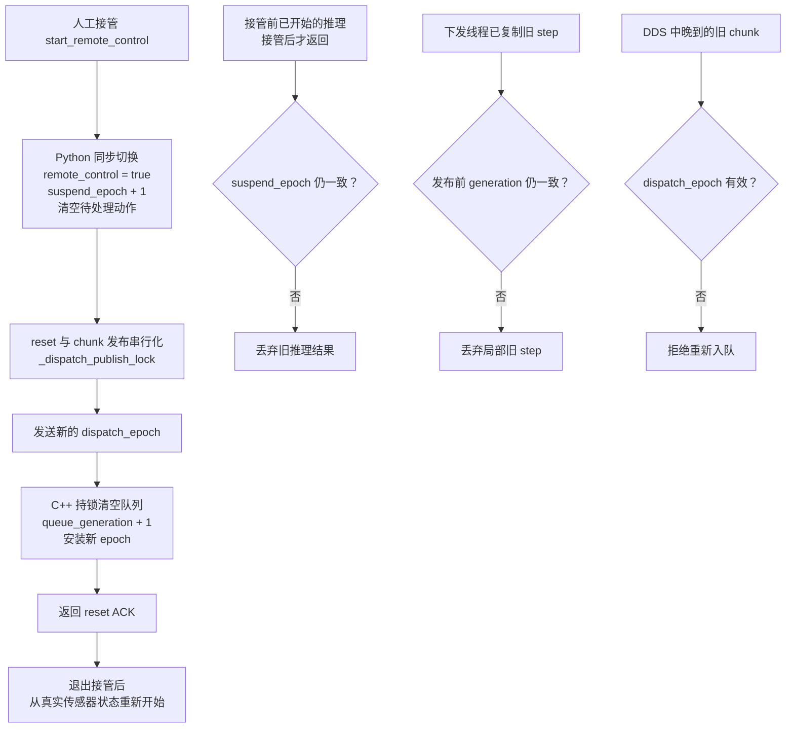

# 机器人接管后“窜一下”：成因、修复与取舍

先澄清：这个问题的直接原因不是 RTC，也不是轨迹平滑。RTC 客户端同样会经过这套接管流程，但真正的问题是控制权切换时，Python、DDS 和 C++ dispatcher 中的旧动作没有在同一时刻失效。只清一个队列，仍可能有旧命令从其他并发路径重新出现。

## 接管时的完整失效链路

图里的三种版本标记含义不同：`_suspend_epoch` 是 Python 控制阶段的版本号，用来作废接管前启动的推理；`dispatch_epoch` 是跨 DDS 的消息有效期，`queue_generation_` 是 C++ 队列版本。三者分别堵住不同竞态，不能合并成一个“RTC 时间轴”。

## 为什么只清队列还会动

第一种竞态发生在 Python。人工接管时，某次基于接管前观测的推理可能还阻塞在网络调用中。即使此时清空 `_action_queue`，旧推理随后返回，仍可能把 stale chunk 填回队列或直接发给 dispatcher。现在接管同步路径会在 `_pc_lock` 保护下提升 `_suspend_epoch`、清理 Python 动作缓存并设置 `remote_control=True`；生产者返回后比较推理开始时保存的版本号，直接发布前也检查接管状态，因此旧结果会被丢弃。

第二种竞态发生在 C++。下发线程可能已经从共享队列复制出一个 step，reset 清空 `steps_` 时删不到这份局部副本。现在清队列和安装新 chunk 都会递增 `queue_generation_`；线程在真正发布前再次校验 generation，并在同一把锁内完成这一拍的双臂、夹爪发布。旧副本因此不会越过 reset。

第三种竞态来自 DDS 顺序。reset 与动作 chunk 使用不同的 DataWriter，不能假设 reset 一定最后到达。客户端递增 `dispatch_epoch`，C++ 安装新 epoch 后拒绝缺少 epoch 或 epoch 更旧的 chunk，并用 ACK 告诉客户端屏障已经生效。这样传输中迟到的旧 chunk 也不能重新入队。

## 实际做出的取舍

接管时会主动作废一次正在进行的推理，即使它稍后可能返回可用结果；恢复后需要重新推理，换来控制权边界清晰。`_dispatch_publish_lock` 和 C++ mutex 会让 reset 等待正在完成的发布临界区，也可能给单拍发布增加少量等待，换来 reset、换队列和发布之间确定的先后关系。epoch 与 ACK 增加了协议字段、兼容分支和超时处理；旧版 Empty reset 只能清缓存，没有同等强度的拒旧保证。

恢复时清掉 `last_arm*_sent` 和 C++ 的历史发布参考，并从最新传感器状态重新建立起点，是为了避免继续使用接管前的位置缓存。这属于控制状态一致性，不是依靠 RTC 裁剪或 blend 掩盖跳变。最后，ACK 只能证明 C++ 已安装屏障；已经进入 DDS 或控制器的命令无法被队列清理撤回，真机是否停止仍要看机器人状态反馈。

[继续阅读：Python 上层控制链优化与工程取舍](./robot-python-control-pipeline-optimizations.md)
