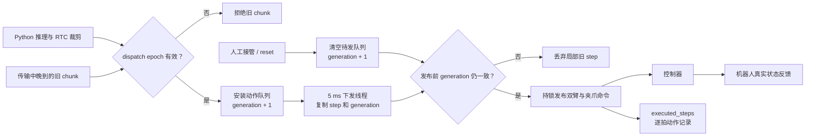

# 机器人动作下发改进与工程取舍

动作块由 Python 提交给 C++ dispatcher，C++ 再按 5 ms 目标周期逐步发布双臂和夹爪命令。这样把高频下发从 Python GIL 和推理线程调度中分离出来，减少动作卡顿。代价是增加一个进程、DDS 通信、实时权限和部署接线；5 ms 只是目标周期，并不等于硬实时保证。

## 完整下发与接管链路

图中有三条不同的时间线：`epoch` 管客户端到 C++ 之间的消息有效期，`generation` 管 C++ 进程内的队列版本，状态反馈才表示机器人真实运动。它们不能互相替代。

## “窜一下”是怎样发生的

人工接管时，Python 和 C++ 都会清理待发队列。但下发线程可能已在清理前把旧 step 复制到局部变量。清空共享队列删不掉这份副本；如果线程继续发布，机械臂在接管后又收到一次旧目标，就会朝原方向突然动一下。

当前代码在清缓存或安装新队列时递增 `queue_generation_`。下发线程取动作时记住 generation，真正发布前再次检查，并在同一把锁内完成整步发布。这样 reset 与发布具有明确顺序。取舍是 reset 可能等待当前发布临界区结束；已经进入 DDS 或控制器的命令也无法由清队列撤回。

## 为什么还需要 epoch

generation 只能拦截 C++ 内部已经取出的旧 step，挡不住传输中晚到的旧 chunk。reset 和动作块来自不同 DDS DataWriter，不能依赖到达顺序。因此客户端给动作块附带单调递增的 `dispatch_epoch`：接管时安装新 epoch，C++ 拒绝更旧的动作块，并通过 ACK 确认屏障已经生效。

代价是增加协议版本、握手与超时处理；旧 dispatcher 的兼容 reset 没有同等强度的拒旧保证。ACK 只说明队列或 epoch 已安装，并不表示机械臂已经停止。

## RTC 连续性与平滑的取舍

RTC 根据 dispatcher 累计发布的步数判断预测过期程度，整段耗尽就丢弃，不退回最后一个旧目标。raw RTC 不使用空间最近点偷偷跳过动作，否则 Python 不知道时间线前进了多少，下一轮条件会错。

部署配置关闭按传输年龄的二次裁剪和通用 blend，优先保持模型时间位置与实际发布位置一致；首个 raw chunk 仍可从新鲜 live pose 对已有前几拍做过渡。这里选择的是可追踪的时间连续性，而不是额外改写轨迹以追求表面平滑。

## 录制与反馈边界

C++ 发布控制命令时同步补发逐拍 `JointState`，解决迁移后训练录制话题为空的问题。插值倍率区分 target 与 confirmed，只记录 chunk 边界真正采用的值。代价是增加逐拍消息和状态握手。

`executed_steps`、chunk ACK 和首发布延迟都属于命令侧证据：它们说明命令已发布或队列已安装，不代表机械臂已经到位。真机回归仍要结合机器人状态、跟踪误差、人工接管和任务成功率。
