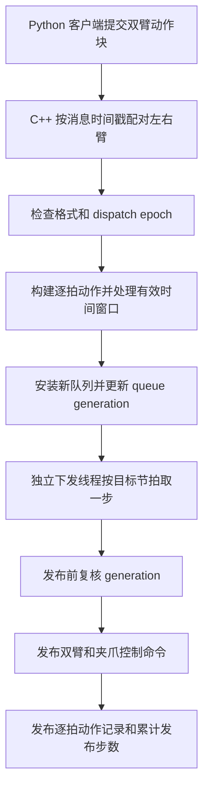

# 机器人动作下发改进与工程取舍

机器人动作下发的优化，需要同时处理发布节拍、人工接管、预测过期和训练录制。当前代码将逐拍下发交给 C++，并围绕队列有效期、RTC 时间线和录制数据增加了保护，目标是让新动作及时接入，同时避免旧动作在接管后继续发出。

以下围绕 Desktop 使用的 C++ dispatcher 路径解释已经实现的改进。EX001 共用部分基础代码；机型专有测试与行为单独注明。每项说明原问题、实现方式、收益、取舍和代码入口。源码基于 x2robot_client 的 `338b15bdc841cc9312b7b9a8fb0edb96acb02a11`；文中行号对应这一版本，其他版本应按函数名定位。

## 一 动作下发链路



左右臂消息的配对入口见 store_chunk（`action_dispatcher_node.cpp:895`）。新队列安装时重置队列索引，并递增内部代号 `queue_generation_`，见 队列安装（`action_dispatcher_node.cpp:1225`）。

下发线程最后调用 publish_step（`action_dispatcher_node.cpp:1354`）：

```cpp
const auto stamp = get_clock()->now();
auto left_pose = pose_msg(step.left_pose, stamp, frame_id_);
auto right_pose = pose_msg(step.right_pose, stamp, frame_id_);
```

每侧位姿按 `[x, y, z, qx, qy, qz, qw]` 封装。左右臂共用本次发布的时间戳，之后分别发送到各自 topic。`pose_msg` 仅填写字段，没有执行坐标变换；`frame_id` 的正确性依赖上游输入约定。相同时间戳用于标记同一逻辑步，不构成多个控制器同时执行的保证。见 消息封装（`action_dispatcher_node.cpp:166`）。

## 二 将逐拍下发移到独立 C++ 线程

### 原问题

Python 推理生产者和动作消费者共享解释器资源。提高 Python 消费线程优先级、使用忙等，可能挤占生产者运行时间，让推理结果更晚到达。

源码记录的历史实测是：约 1 秒的服务端推理，在客户端侧曾被拖到 1.3–3.8 秒，`send_ms` 偶发达到 452 ms。该数字来自历史注释，用来说明当时定位到的 GIL 和线程调度问题。见 消费者调度说明（`robot_client_base_async.py:3991`）。

### 已实现的改进

- dispatcher 模式下，Python consumer 负责提交动作块，禁用自身的实时优先级和忙等。
- C++ 独立线程使用 `steady_clock` 和 `sleep_until` 管理目标下发节拍，默认周期为 5 ms。
- C++ 尝试设置 CPU 亲和性与 `SCHED_FIFO`；多核时，配套 launch 为 dispatcher 预留最后一个逻辑 CPU，并限制 infer 进程使用其余 CPU。
- 大幅落后于 deadline 时重设下一次 deadline，避免持续追赶已经过去的调度时刻。小幅落后的处理仍受当前循环与阈值约束。

代码入口：线程调度配置（`action_dispatcher_node.cpp:804`）、下发循环（`action_dispatcher_node.cpp:1508`）、deadline 重设（`action_dispatcher_node.cpp:1626`）、CPU 分配（`infer_with_dispatcher.launch.py:29`）。

### 收益与取舍

逐拍发布减少了对 Python GIL 和推理线程调度的依赖，但引入了独立进程、ROS 通信和部署配置。5 ms 是目标发布周期，实际节拍仍取决于操作系统、CPU 负载、DDS 和实时权限；这段实现没有提供硬件层面的硬实时保证。

## 三 接管时同时清理缓存并阻止旧动作重新发布

### 原问题

源码明确记载：人工接管时，Python 已经清空自己的队列，但 C++ 仍缓存着旧目标，继续下发会让机械臂朝旧目标突然移动，与人工抢控制。见 历史问题注释（`action_dispatcher_node.cpp:681`）。

例如模型原来规划从 A 移到 B，人工接管后将机械臂移到 C，残留的 B 目标仍可能使机械臂从 C 朝 B 运动。现场所说的“窜一下”描述的就是这种非预期运动，幅度由具体目标和控制器行为决定。

### 已实现的改进

清理函数会删除待发队列、尚未配对的左右臂消息、在途成员引用和旧的轨迹衔接参考，并递增 `queue_generation_`。清掉衔接参考，是为了避免恢复后继续用接管前的位姿作为锚点。见 clear_action_cache_locked（`action_dispatcher_node.cpp:832`）。

仅清队列仍存在一个并发窗口：

```text
下发线程：将旧动作复制到局部变量 step
接管线程：清空队列并更新 generation
下发线程：局部变量还在，可能继续发布旧动作
```

当前实现把 generation 随 step 一起取出，在真正发布之前再次检查；检查和整步发布共用同一把 mutex，因此接管清理与单步发布具有明确的先后顺序。

```cpp
published = publish_if_current_generation(
  mutex_, queue_generation_, step_generation, current_generation, [&]() {
    publish_step(step);
    previous_published_step_ = last_published_step_;
    last_published_step_ = step;
    inflight_step_.reset();
  });
```

代码入口：取出动作并保存代号（`action_dispatcher_node.cpp:1533`）、发布前检查（`action_dispatcher_node.cpp:1553`）、持锁检查和发布（`dispatch_epoch_guard.hpp:30`）。

### 收益与取舍

失效队列中已经取出的局部 step 也能被拦住。代价是 reset 或队列替换可能等待当前发布临界区完成。这一保护约束软件发布顺序，已经进入 DDS 或下游控制器的命令仍需要底层接管或停止机制处理。

## 四 使用 epoch 阻止晚到旧动作重新进入队列

### 原问题

reset 与动作块通过不同 DDS DataWriter 发送，不能依赖它们的到达顺序。即使队列已经清空，接管前发送的旧动作块仍可能随后到达；构建动作队列期间也可能发生新的 reset。

### 已实现的改进

客户端随动作块携带 `dispatch_epoch`，即跨消息使用的动作代次。C++ 接受更新的 epoch 后清理旧缓存，并拒绝较旧或缺少 epoch 的动作块。构建动作前检查一次，构建完成、安装队列前再检查一次，覆盖“计算期间发生 reset”的窗口。

reset 回传已接受的 epoch；Python 等待 `ack_epoch >= requested_epoch`。更高代次已安装，意味着较早的 reset 已被覆盖，因此无需强求 ACK 完全相等。携带 epoch 和有效 chunk ID 的 raw chunk 安装后，还会回传 `(epoch, chunk_id)` ACK。

| 机制 | 作用范围 | 解决的问题 |
| --- | --- | --- |
| `queue_generation_` | C++ 进程内部，清缓存或替换队列时更新 | 拦截已经取出但尚未发布的失效 step |
| `dispatch_epoch` | 客户端和 C++ 之间的消息协议 | 拒绝接管前晚到的旧动作块 |
| reset ACK | 已安装的 epoch 屏障 | 确认清理请求已在 dispatcher 生效 |
| chunk ACK | 某个 raw chunk 的安装结果 | 区分动作块已发送与已被 dispatcher 接受 |

代码入口：reset 与 ACK（`action_dispatcher_node.cpp:867`）、构建前检查（`action_dispatcher_node.cpp:934`）、安装前重检（`action_dispatcher_node.cpp:1034`）、chunk ACK（`action_dispatcher_node.cpp:1237`）、Python ACK 条件（`ros_publisher.py:756`）。

### 收益与取舍

这套协议覆盖 epoch 切换前后、跨 DataWriter 的旧动作块晚到，代价是能力协商、等待 ACK 和超时处理。客户端对旧 dispatcher 仍保留无 ACK 的 `Empty` reset 兼容分支；当前 C++ 的该兼容分支还会清除 epoch enforcement。因此跨消息的拒旧保证依赖持续使用 epoch 协议，不能将新旧 reset 路径视为同等保护。见 客户端分支（`ros_publisher.py:782`）、兼容清理实现（`action_dispatcher_node.cpp:854`）。

## 五 校验输入并从新鲜状态衔接首个动作块

### 已实现的改进

输入校验覆盖了左右臂格式一致性、轨迹非空、长度一致和数值有效性。dense 路径要求每侧每步恰好为 `pose(7) + gripper(1)`，并校验四元数范数；raw 路径构建失败同样拒绝动作。构建校验失败时清理旧缓存，同时保留已经建立的 epoch 屏障。

raw 首个动作块或 reset 后的首块，在缺少可用命令参考时，需要两侧 live pose 都存在且本地更新时间未超过阈值，默认阈值为 250 ms。随后使用 `shape_first_dispatch_ramp` 对已有前几拍做过渡，不额外插入 tick；如果可用轨迹只有一个 tick，则保持该目标，没有多拍渐变。

代码入口：格式检查（`action_dispatcher_node.cpp:923`）、构建失败处理（`action_dispatcher_node.cpp:962`）、dense 数值与四元数检查（`action_dispatcher_node.cpp:1278`）、首块 live pose 检查（`action_dispatcher_node.cpp:1096`）、首块过渡实现（`action_dispatcher_node.cpp:494`）。

### 收益与取舍

异常输入会被拒绝，恢复时也不再盲用接管前的锚点。代价是状态缺失或更新过慢时首块不能执行；首块过渡还会改变部分命令数值。本地更新时间检查衡量的是客户端收到状态后的新鲜度，不能单独证明传感器采样时间准确。上述格式检查也不等同于完整的碰撞、关节极限或动力学安全验证。

## 六 保持 RTC 时间线并处理过期预测

### 已实现的改进

raw RTC 使用累计发布步数计算动作时间位置，优先按 `executed_now - request_exec` 确定已经经过的前缀。如果预测的整个时间窗口已经耗尽，就丢弃该动作块，不钳回最后一个过时目标继续发送。

空间最近点可以用于诊断，但 raw 路径不会据此跳过轨迹：未上报给 Python 的跳点会使下一轮 RTC 的 `s_model` 与实际下发位置不一致。

配套 launch 显式设置：

```python
"enable_align_blend": False,
"skip_received_queue_by_age": False,
```

这关闭了额外的通用混合和按 ROS 传输年龄二次裁剪；raw 自身的有效窗口计算，以及上一节的首块过渡仍然存在。关闭通用 blend 不能理解为 C++ 永远逐值原样下发。

Python 端还按旧队列余量处理 RTC 前缀超时：旧队列足够支撑重试时，拒绝超时结果；旧队列不足、预测仍有可用尾部时，允许降级衔接，并清除下一轮使用的原预测 guidance；尾部已耗尽时直接丢弃。

代码入口：有效时间窗口（`action_dispatcher_node.cpp:993`）、禁止最近点改变 raw 时间位置（`action_dispatcher_node.cpp:1169`）、launch 配置（`infer_with_dispatcher.launch.py:59`）、拒绝或降级的判断（`robot_client_base_async.py:2738`）、尾部耗尽与 guidance 清理（`robot_client_base_async.py:3676`）。

### 收益与取舍

时间位置更加明确，避免重复裁剪或隐式跳点破坏后续 RTC 条件。保留可用尾部有助于减少等待，但超出原前缀约束后，连续性条件已经变弱，所以代码将其标记为降级并清除后续 guidance。这一分支不能解释为任务成功率已经提升。

## 七 补齐逐拍录制并记录实际采用的倍率

### 原问题

逐拍执行迁到 C++ 后，Python 不再逐拍发布 action 录制话题。源码明确记载：两个话题原本为空，导致 rosbag 解析报错。见 录制修复说明（`action_dispatcher_node.cpp:218`）。

### 已实现的改进

`publish_step` 在控制命令发布时补发左右臂 `JointState`，包含位姿和夹爪值；该功能默认开启。训练回流因此能够获得 dispatcher 实际提交的逐拍命令。

调速同时区分 `target` 与 `confirmed`：目标倍率由 C++ 持有，Python 在 chunk 边界实际应用后确认，C++ 高频录制话题发布 confirmed。delta 操作改成 service，避免旧 topic 周期重发造成重复累加。会话 generation 与初值握手会过滤旧 target；超时后拒绝首块执行。

代码入口：逐拍发布（`action_dispatcher_node.cpp:1371`）、target 与 confirmed 分工（`interpolate_multiplier_bridge.py:15`）、旧 target 过滤和首块握手（`interpolate_multiplier_bridge.py:623`）、confirmed 高频发布（`action_dispatcher_node.cpp:1603`）。

### 收益与取舍

动作和倍率记录更贴近软件实际采用的值，减少训练数据与运行配置不一致的问题。代价是额外的逐拍录制消息，以及调速可能等待到 chunk 边界才生效。动作记录与 confirmed 都属于软件命令侧证据；失败数据回流时，仍需分别保存机器人实际状态和任务结果。

## 八 增加发布进度反馈和延迟诊断

`executed_steps` 在每次完成控制命令发布后递增，普通队列 reset 不清零。它在当前 dispatcher 进程生命周期内提供绝对发布进度；进程重启需要重新建立基线。同步客户端可等待 `baseline + chunk_size`，RTC 使用它对齐命令时间线。空闲时继续发布心跳，避免客户端无法区分“暂时没动作”与“反馈已经失效”。

| 信号或日志 | 当前实现表示什么 | 不能据此认定什么 |
| --- | --- | --- |
| reset ACK | epoch 屏障已经安装 | 机械臂已经停止或到位 |
| chunk ACK | raw 动作块已经被接受并安装 | 整个动作块已经执行完成 |
| `executed_steps` | dispatcher 累计发布步数 | 电机或末端累计到位步数 |
| `INFERENCE_TO_ACTION` | 推理完成到首个命令发布的时间 | 推理完成到机械运动响应的时间 |
| `DISPATCH_DIAG` | 发布数量、唤醒迟到与发布耗时 | 全链路任务成功率 |

代码入口：计数递增（`action_dispatcher_node.cpp:1378`）、同步等待与重启检测（`sync_cpp_dispatch.py:25`）、首发布延迟（`action_dispatcher_node.cpp:1567`）、空闲心跳和诊断（`action_dispatcher_node.cpp:1591`）。

这套反馈减少了高频同步读取机器人状态的需求，也让网络、推理后等待和发布抖动更容易区分。物理跟踪误差仍需要机器人状态反馈。配套 launch 将 `diag_log_period_s` 设为 0，聚合诊断日志并非默认持续输出。

## 九 将部署接线与调度配置纳入启动流程

配套 launch 同时启动 infer 和 dispatcher，设置 `X2ROBOT_ACTION_DISPATCHER=1`，配置 CPU 分工，支持 dispatcher 崩溃后重启，并在 infer 退出时关闭整个 launch，交给容器重启策略处理。

启动脚本还记录了实际部署问题：裸写 `source ... && A & B` 会使环境初始化进入后台任务，前台进程缺少 ROS 环境，出现找不到 package 的崩溃。统一 launch 避免重复手写这类 shell 组合。实时权限仍需由容器配置提供，单独打包二进制并不代表 dispatcher 已经启用。

代码入口：部署问题及权限说明（`infer_with_dispatcher.launch.py:1`）、启用与重启配置（`infer_with_dispatcher.launch.py:42`）、infer 退出处理（`infer_with_dispatcher.launch.py:91`）、部署接线说明（`README.md:146`）。

## 十 当前测试覆盖范围

现有 EX001 时序回归测试（`test_ex001_timing_regressions.py:71`）覆盖了两类 Python 行为：只剩一个目标点时，生成轨迹的首末值分别为锚点和目标；以及模拟 50 ms 停顿后恢复控制节拍而不追赶式连发。测试没有连接 ROS 或机械臂，不能替代 Desktop C++ 的 epoch、generation、DDS 乱序、录制完整性和真机闭环验证。

本文的“已实现”表示当前工作树中存在相应执行逻辑。目标发布频率、保护分支和录制修复分别解决时序、有效期与数据问题；任务是否完成、末端是否跟上以及人工接管是否及时，仍需结合对应版本的运行数据判断。

## 十一 源码定位索引

以下路径以 x2robot_client 仓库为根目录。正文使用文件名和行号简写，完整路径见下表。

| 文件 | 仓库内路径 | 主要职责 |
| --- | --- | --- |
| `action_dispatcher_node.cpp` | `x2robot_action_dispatcher_cpp/src/action_dispatcher_node.cpp` | 队列安装、下发循环、录制和状态发布 |
| `robot_client_base_async.py` | `x2robot_client/x2robot_client/robot_client_base_async.py` | Python 生产消费调度与 RTC 过期结果处理 |
| `infer_with_dispatcher.launch.py` | `x2robot_infer/launch/infer_with_dispatcher.launch.py` | 进程启动、CPU 分工和实际参数设置 |
| `dispatch_epoch_guard.hpp` | `x2robot_action_dispatcher_cpp/include/x2robot_action_dispatcher_cpp/dispatch_epoch_guard.hpp` | 发布前的队列代号校验与锁保护 |
| `ros_publisher.py` | `x2robot_client/x2robot_client/ros_publisher.py` | reset、epoch 协议与 ACK 等待 |
| `interpolate_multiplier_bridge.py` | `x2robot_client/x2robot_client/interpolate_multiplier_bridge.py` | 倍率 target、confirmed 与会话握手 |
| `sync_cpp_dispatch.py` | `x2robot_client/x2robot_client/sync_cpp_dispatch.py` | 同步客户端的发布进度等待 |
| `README.md` | `x2robot_action_dispatcher_cpp/README.md` | dispatcher 协议和部署接线说明 |
| `test_ex001_timing_regressions.py` | `x2robot_client/test/test_ex001_timing_regressions.py` | EX001 Python 时序回归测试 |

[Harrix 机器人推理优化详解](./robot-inference-optimization.md) · [返回 Harrix 经历页](../x2robot.md) · [返回主页](../README.md)
