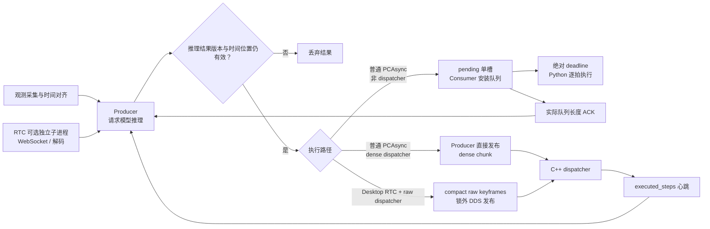

# Python 上层控制链优化与工程取舍

这里的“上层”指 C++ dispatcher 之上的 Python 控制链：观测采集、异步推理、结果有效期、动作队列、发布协议和故障收敛。它不等同于模型算子加速，也不把 RTC 时间线问题和人工接管竞态混为一谈。源码核对基于 x2robot_client `338b15b`。

## 三种实际下发形态

`_suspend_epoch` 可以理解为“当前控制阶段的版本号”。推理开始时保存版本；如果推理期间发生人工接管，版本就递增。旧请求回来后发现保存值与当前值不同，说明它使用的是接管前观测，结果会被丢弃。它和 chunk ID 不同：前者区分接管前后，后者区分同一阶段内的不同动作块。

## 推理与执行并行

`ProducerConsumerAsyncBase` 把采集、远端推理和动作消费拆成 producer、consumer 两个线程。当前队列执行期间可以准备下一块动作，减少串行等待；它隐藏的是流水线等待，并没有缩短单次模型推理。

Desktop RTC 的默认参数会启用 producer 子进程，也允许显式关闭。启用后，WebSocket 接收、msgpack 解码和动作准备移到独立进程；请求与结果队列均为单槽，子进程重建自己的模型连接，降低重解码与父进程控制线程争抢 GIL 的影响。代价是 IPC 拷贝、进程生命周期和 fork 兼容性；本地清队列也不能取消服务端已经开始的计算，只能通过 request ID 与 suspend epoch 丢弃晚到结果。

dispatcher 接管 5 ms 下发后，Python RTC consumer 会关闭 `SCHED_FIFO` 与忙等，把 CPU 和 GIL 让给 producer。源码注释记录旧配置曾把约 1 秒推理拖到 1.3–3.8 秒，`send_ms` 偶发达到 452 ms；这是历史定位数据，不是本次重新测量。

## 用真实队列余量控制推理节奏

普通 PCAsync 不再仅按配置的 action horizon 猜测下一次请求时机。consumer 完成过期裁剪与队列安装后，用 chunk ID 回传实际剩余长度；producer 再扣除下一轮周期估计和约 5% reserve，决定等待多久。即使预算已经耗尽，也至少等待一个 control tick，避免连续推理长期占用 GIL。ACK 超时会采用保守长度继续运行。

consumer 使用单调时钟的绝对 deadline。单步发送耗时会从本周期预算中扣除；若落后超过 20 ms，则从当前时刻重建基准，避免长暂停后追赶式连发。取舍是放弃追回旧时间表，而且 Python 路径仍不具备硬实时保证。

RTC 使用另一套预取规则：按 `execute_horizon × multiplier` 触发下一次请求，并为预计模型延迟保留动作。可选执行窗口 cap 默认关闭，防止窗口过短造成周期性断供。

## 统一执行时间线

RTC direct/raw 主路径先完成观测采集，再在准备发起请求时记录执行位置。它要求使用新鲜的 dispatcher 绝对 `executed_steps`，并让请求与回包处于同一个计数域；反馈默认超过 350 ms 就视为陈旧，counter 回退则按 dispatcher 重启重新建基线。response age 只作诊断，不直接推进 raw 轨迹位置。

普通 PCAsync 在采集观测前保存计数快照；通用 base 和 legacy dense 兼容路径在 dispatcher 反馈缺失或陈旧时，还保留 Python 本地增量和受当时队列长度限制的墙钟估算。因此不能把 RTC raw 的严格绝对时间线套到所有路径。

RTC raw 请求把 `request_exec_absolute` 一直带到 C++，回包后用 `done - request` 计算轨迹已经消耗的前缀。这样避免把 Python 估算值与 C++ 计数混算。这个计数表示命令已发布，不代表电机到位；物理跟踪仍要读取机器人状态。

## compact raw 与锁外发布

Desktop RTC 在 `end_pose`、raw 能力完整且反馈新鲜时，只发送模型的 xyz+rpy+gripper keyframes，把稠密插值和逐 tick 消息构造交给 C++。`_RawDispatchSteps` 只保存逻辑长度，用于切片与 cap 记账，减少数百个 Python dict、IPC pickle 和 DDS 负载。它不是零拷贝，也不覆盖 joints、positioning 或旧 dispatcher。

producer 在 `_pc_lock` 内完成队列对齐、可选 cap 和 active chunk 状态提交，随后释放锁，再构造 ROS 消息并发布；独立的 publish/reset barrier 维持与接管 reset 的顺序。这样把较重的 ROS packing 与 DDS 工作移出临界区，减少 `lock_update` 抖动，代价是需要在发布前后重复校验 epoch、chunk ID 和运行状态。

raw 协议只有同时发现 `raw_euler_v1`、`dispatch_epoch_v1`、`chunk_ack_v1` 才启用，并等待精确的 `(epoch, chunk_id)` ACK。ACK 丢失时，上层会先尝试 reset 可能已经安装的队列，再把错误传给会话。协议更可靠，但增加了能力协商、往返等待和超时分支。

## 过期 RTC 结果如何取舍

这部分首先是正确性保护，不是速度优化。结果超出本次 RTC 前缀约束时，如果旧队列还足以覆盖一次重试，就丢弃结果；如果旧队列接近耗尽但新预测仍有未执行尾部，则允许降级接续，并清除下一轮 `_prev_action_pred`；整段预测已经耗尽时直接丢弃。当前 launch 关闭了可选通用 align blend，因此“保留尾部”不等于保证每次降级切换都被平滑补偿。

## 输入侧与实现边界

Desktop RTC 用后台源缓冲按 head camera 时间戳分别选择最接近的本体状态和左右相机帧，减少多传感器观测错位；偏差超过阈值会限频告警。图像还支持可选缩放与 JPEG 重编码，降低请求带宽，但默认高度为 0，即保留原 JPEG，开启后要承担端侧解码、缩放和画质损失。

普通 Desktop PCAsync 的 C++ dense 路径有一个重要边界：producer 在 `_prepare_action_chunk()` 中先把完整 dense chunk 发给 dispatcher，consumer 随后才处理自己的 elapsed 对齐与 blend。因此不能宣称该路径的 Python 影子队列与 C++ 实际队列必定一致，也不能把 RTC raw 的绝对计数和 ACK 保证套到普通 PCAsync。

当前自动测试没有覆盖 capabilities、epoch/ACK、DDS 乱序、反馈失联或真机跟踪。上述收益来自源码结构与已有注释；延迟、断供率和任务成功率仍需在目标机器上做闭环回归。

## 代码入口

| 机制 | 源码位置 |
| --- | --- |
| 普通 producer / consumer 与真实队列长度 ACK | `robot_client_base_async.py:1923`、`:1973`、`:2192` |
| dispatcher 反馈新鲜度与同域计数 | `robot_client_base_async.py:1516`、`:1533`、`:1581` |
| RTC 结果筛选与可用尾部 | `robot_client_base_async.py:2734`、`:3676` |
| 锁外 direct dispatch | `robot_client_base_async.py:2900`、`:2982` |
| producer 子进程与有界 IPC | `robot_client_base_async.py:3078`、`:3169` |
| compact raw 发布 | `desktop_client_rtc_async.py:624`、`ros_publisher.py:648` |
| 多源观测时间对齐 | `desktop_client_rtc_async.py:841`、`:1267` |

[接管后“窜一下”的成因与修复](./robot-action-dispatch-improvements.md) · [Harrix 机器人推理优化详解](./robot-inference-optimization.md) · [返回主页](../README.md)
